<div align="center">

# MLX UI

**在 Apple Silicon 的 Mac 上本地运行大模型的聊天工具**

对话、记忆和推理都留在你的电脑上，数据库全程加密。

</div>

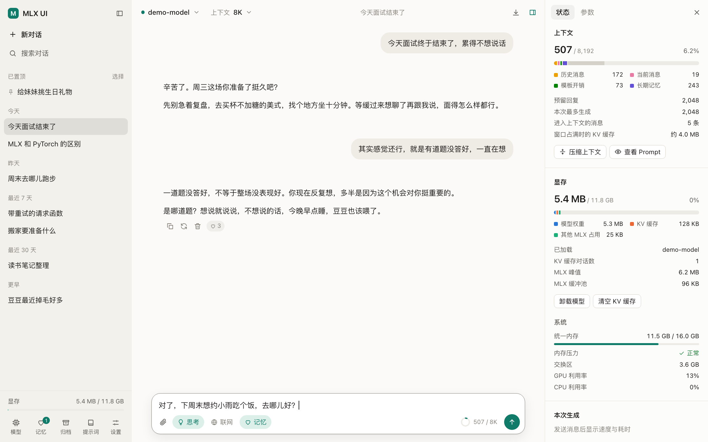

<p align="center"><sub>本文的截图都是虚构的演示数据，运行的是一个很小的测试模型，所以显存读数很低，不代表真实模型的占用。</sub></p>

## 主要功能

- **像在线 AI 一样的对话**：流式输出、停止、重新生成、编辑后重发、继续生成、版本分支切换
- **反思记忆**：从日常聊天里慢慢认识你，下次自然地用上，每一条都能查看和管理
- **上下文和显存看得见**：token 分项统计、KV 缓存、模型权重、内存压力、生成速度
- **模型自己选**：下载、搜索、手动添加本地文件夹，每个对话单独选模型和上下文大小
- **可选的联网搜索**：默认关闭，只发送一行检索词，回答带来源
- **隐私优先**：AES-256 加密存储，不留内容日志，删除时一并清除相关痕迹
- **OpenAI 兼容接口**：其他工具可以直接调用 `/v1/chat/completions`

## 快速开始

需要 Apple Silicon 的 Mac 和 [uv](https://docs.astral.sh/uv/)（`brew install uv`）。

```bash
git clone https://github.com/TTStick/mlx-webui-tool.git
```

```bash
cd mlx-webui-tool
```

```bash
./start.command
```

也可以在访达里直接双击 `start.command`。首次运行会自动创建 Python 环境（约 450 MB，需要联网），完成后打开 <http://127.0.0.1:8420>。

第一次打开时还没有模型，下载一个或者添加你已有的模型文件夹就能开始。16GB 内存建议从 `Qwen3-4B-Instruct-2507-4bit` 起步。

| 启动参数 | 作用 |
|---|---|
| `--port 9000` | 指定端口，默认 8420，被占用时自动往后找 |
| `--no-browser` | 不自动打开浏览器 |
| `--host 0.0.0.0` | 允许局域网访问（没有登录验证，请只在可信网络使用） |

## 聊天

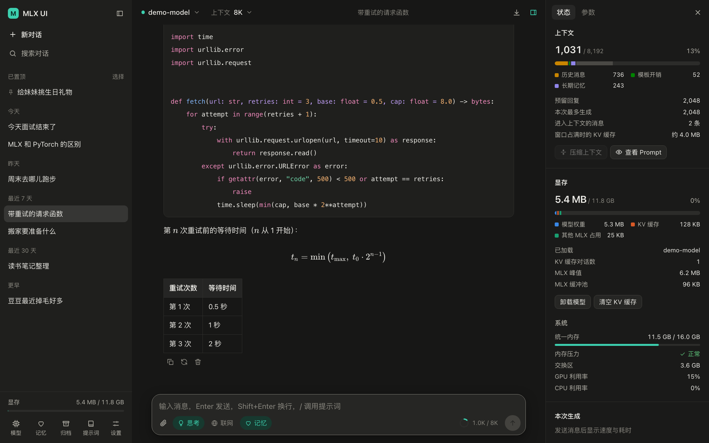

支持 Markdown、代码高亮、LaTeX 公式和表格，模型的思考过程可以折叠。可以上传文本、代码、PDF、Word 作为上下文，输入 `/` 调用提示词。

重新生成和编辑都会保留旧版本，可以来回切换。生成任务在后台排队，刷新页面不会中断。

对话历史按时间分组，支持重命名、置顶、归档、批量操作和全文搜索（⌘K），也能导出 Markdown、JSON 或备份整个数据库。

## 上下文与显存

<table>
<tr>
<td width="340" valign="top">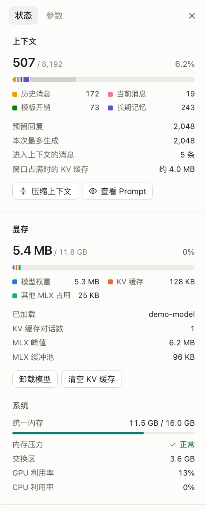</td>
<td valign="top">

本地跑模型，最需要知道的是“还放得下多少”。右侧面板（⌘I）实时告诉你：

**上下文**

- 分项统计系统提示、记忆、联网资料、附件、历史、当前消息和模板开销
- 打字时实时更新，超出窗口时自动丢弃最早的轮次，并在对话里标出分界线
- 可以让模型把旧对话压缩成摘要，也能查看实际发送的完整 Prompt

**显存**

- 拆分成模型权重、KV 缓存和其他 MLX 占用
- 选择上下文大小时，直接显示会多占多少显存
- 显示内存压力、交换区、GPU 和 CPU 利用率

**性能**

- 每次生成的速度、首字延迟、缓存命中率和峰值显存
- 多轮对话复用 KV 缓存，追问时不用重算

</td>
</tr>
</table>

## 反思记忆

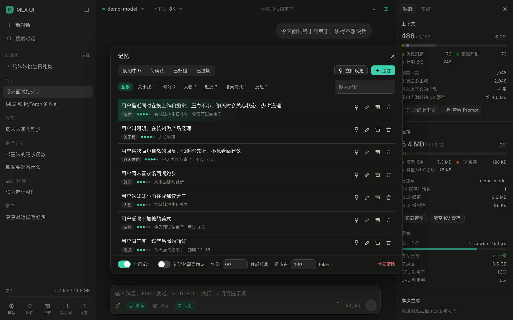

对话停下来一分钟后，模型会在空闲时读一遍新内容，记下你的习惯、在意的人和近况，之后聊天时像老朋友一样自然地提起。

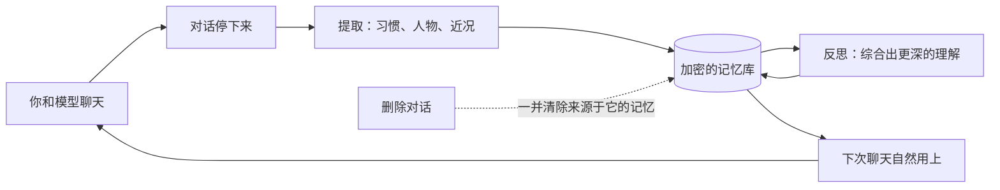

- **不打扰**：反思只在空闲时进行，你一发消息就立刻让路。说“记住……”或“忘掉……”会尽快处理
- **能管理**：点左下角“记忆”可以查看、编辑、钉住、归档、删除，也可以开启“新记忆需要确认”
- **有分寸**：手机号、证件号、密码这类内容会被过滤，附件和网页内容不会进入记忆
- **可追溯**：每条记忆都记录来源对话，你亲手改过或钉住的内容，模型不能再动
- **省显存**：稳定的记忆放在系统提示里，随话题变化的放在最后一轮，尽量不让 KV 缓存失效

记忆的质量取决于所用的模型，太小的模型可能提炼不出有用的内容。每段对话都可以单独关闭记忆。

## 模型

<table>
<tr>
<td width="50%">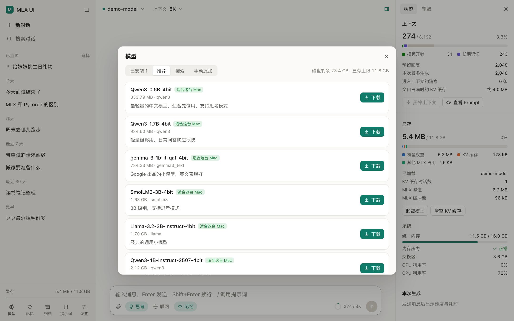</td>
<td width="50%">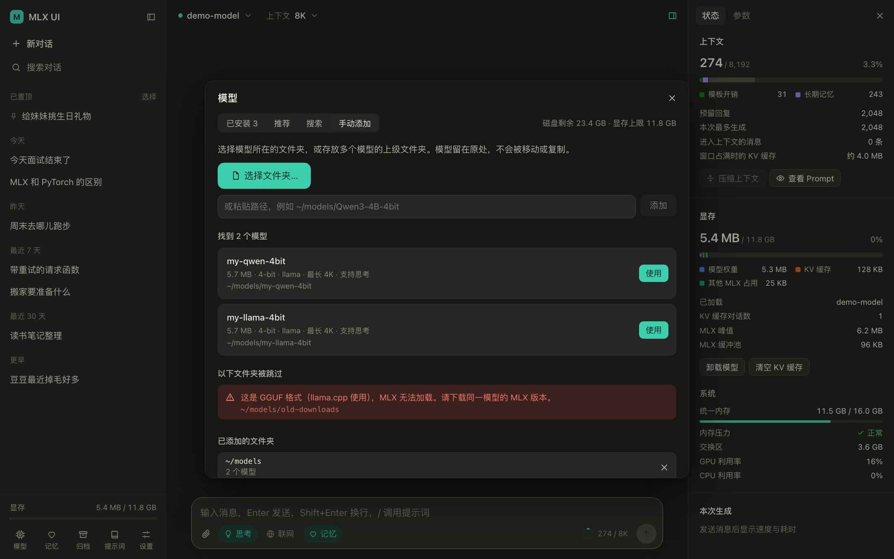</td>
</tr>
<tr>
<td valign="top"><b>下载</b>：推荐列表会根据本机显存提示是否放得下，下载前检查磁盘空间，可以切换 hf-mirror 镜像。</td>
<td valign="top"><b>手动添加</b>：点“选择文件夹…”或粘贴路径，模型留在原处不会被复制。放不进来的文件夹会告诉你原因，比如 GGUF 格式或权重分片不全。</td>
</tr>
</table>

手动添加的文件夹里需要有 `config.json`、`.safetensors` 权重和分词器文件，最好是 MLX 版本（例如 `mlx-community` 上的模型）。也可以选存放多个模型的上级文件夹，最多往下找 3 层。

目前只支持文本模型，暂不支持图片输入。

## 联网搜索

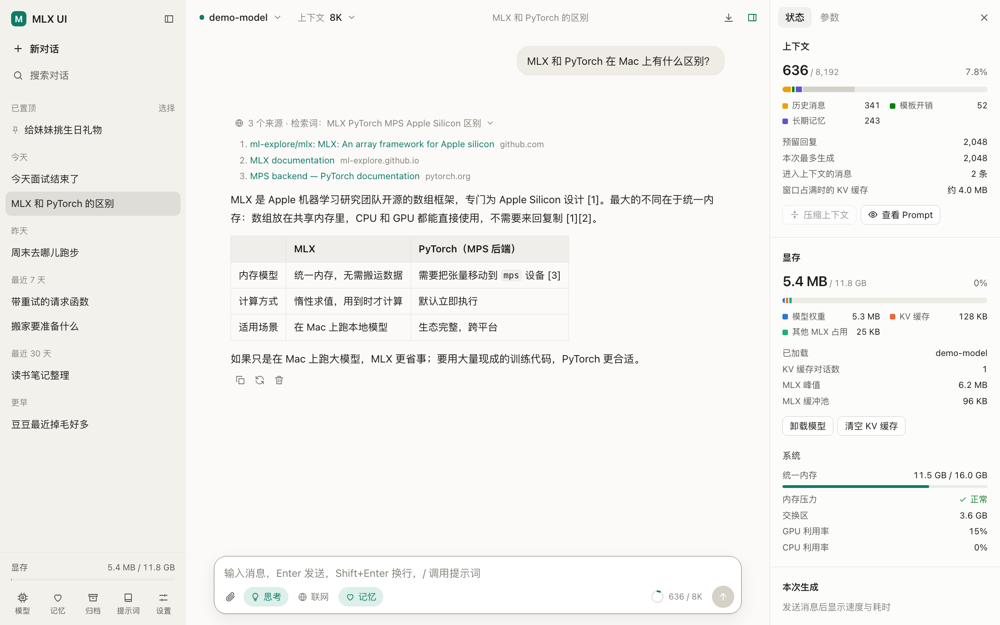

输入框点“联网”才会搜索，发送给搜索服务的只有模型写的一行检索词，记忆和附件不会发送。网页内容只用于当前这一轮，不写入数据库。

在“设置 → 联网搜索”选择服务：

| 服务 | 配置 | 能搜什么 |
|---|---|---|
| 维基百科（默认） | 不用配置 | 只有百科，查不到新闻和普通网页 |
| SearXNG | 自己运行一个实例 | 全网，隐私最好 |
| Brave / Tavily | 申请 API Key | 全网，查询由对方处理 |

用 Docker 运行本地 SearXNG，然后把实例地址填成 `http://127.0.0.1:8888`：

```bash
docker run -d --name searxng -p 127.0.0.1:8888:8080 -e SEARXNG_SEARCH_FORMATS=html,json searxng/searxng
```

## 隐私与安全

<table>
<tr>
<td width="60%">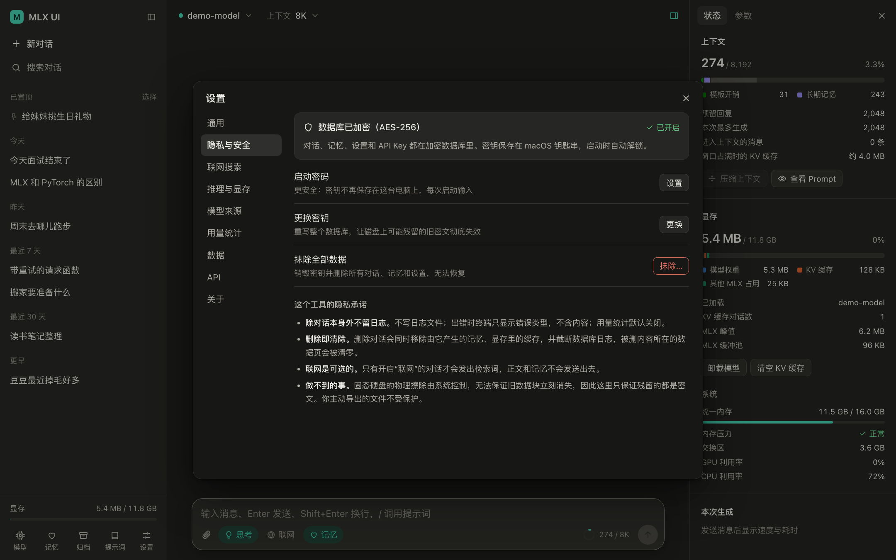</td>
<td width="40%">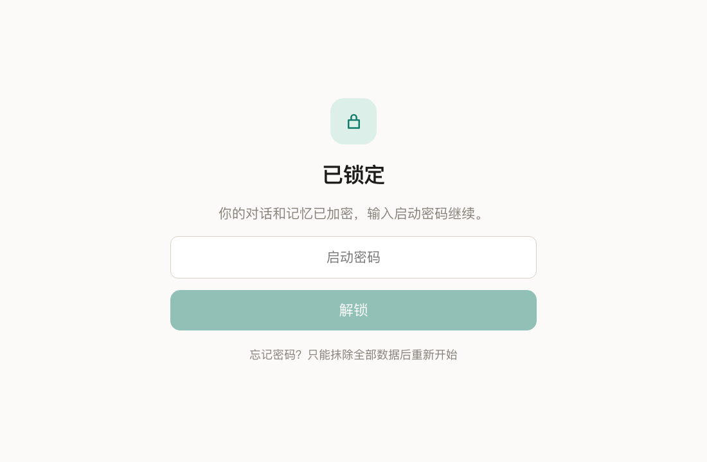</td>
</tr>
</table>

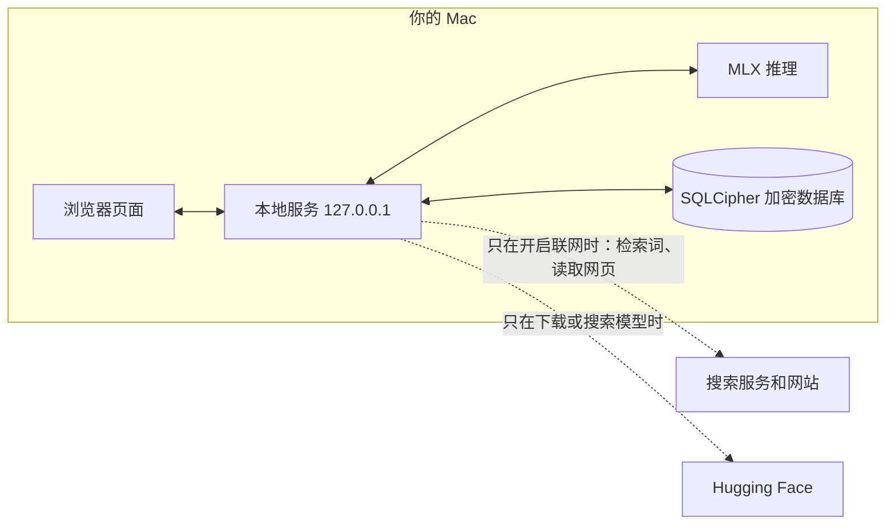

- **加密存储**：对话、记忆、设置和 API Key 都在 SQLCipher（AES-256）加密数据库里。默认把随机密钥放在 macOS 钥匙串，启动时自动解锁
- **启动密码**：在“设置 → 隐私与安全”开启后，磁盘上不再保存密钥，还能手动锁定或空闲自动锁定。忘记密码数据无法找回
- **不留日志**：不写日志文件，终端只显示错误类型，用量统计默认关闭
- **删除即清除**：删除对话会一并移除由它产生的记忆和显存里的缓存，清零被删内容所在的数据页并截断 WAL

**做不到的事，也说清楚：**

- 固态硬盘的物理擦除由系统控制，这里只保证残留的都是密文。“更换密钥”可以让旧密文彻底失效，建议同时开启 FileVault
- 钥匙串模式防的是文件被拿走，防不了能登录你账号的人或恶意程序；启动密码更强
- 联网时，搜索服务能看到检索词，被读取的网站能看到你的 IP
- 你主动导出的文件没有加密；换电脑时密钥不会跟着走，要用“设置 → 数据”导出再导入

## 快捷键

| 按键 | 作用 |
|---|---|
| ⌘K | 搜索对话 |
| ⌘⇧O | 新对话 |
| ⌘B | 显示或隐藏侧栏 |
| ⌘I | 显示或隐藏右侧面板 |
| Esc | 停止生成 |

## 数据位置

| 内容 | 路径 |
|---|---|
| 对话、记忆和设置（加密） | `~/Library/Application Support/mlxui/mlxui.db` |
| 下载的模型 | `~/.cache/huggingface/hub`（可在设置中更改） |

## 开发

```bash
uv pip install --python .venv/bin/python pytest httpx
```

```bash
.venv/bin/python -m pytest
```

测试会现场生成随机权重的微型模型，并用本地桩服务器模拟 Hugging Face，不需要联网，也不会碰你的钥匙串。前端没有构建步骤，依赖都在 `mlxui/static/vendor/`。
